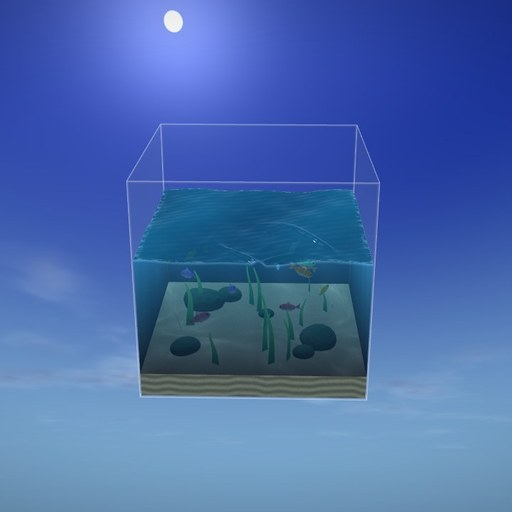

# Ocean Cube — wallpaper animado com clima real

Um oceano dentro de um cubo de vidro, no centro da tela, que reage ao **clima real da sua cidade**: sol, nuvens, chuva, garoa, tempestade com raios, vento, neblina, neve, dia e noite (com o nascer e o pôr do sol de verdade).
Feito para o **Wallpaper Engine** (wallpaper do tipo *Web*), com Three.js/WebGL.



## Recursos

- **Clima ao vivo** pela [Open-Meteo](https://open-meteo.com/): gratuita e sem chave de API. Atualiza a cada 15 minutos (configurável) e guarda o último clima para funcionar offline.
- **Ondas guiadas pelo vento real**: a altura, a direção e a espuma seguem a velocidade e a direção do vento na sua cidade.
- **Dia e noite reais**: o sol e a lua cruzam o céu conforme os horários de nascer e pôr do sol da sua localização.
- **Interação com o mouse**: a câmera acompanha o mouse (paralaxe). Passar o mouse sobre a água cria ondulações que batem e voltam nas paredes do cubo, e clicar faz um "splash". À noite, a água agitada brilha (bioluminescência).
- **Peixes** que nadam em cardume, fogem do mouse, descem para o fundo em tempestades e brilham de leve à noite.
- **Chuva, neve e raios na tela inteira**. A chuva também cria ondulações na superfície e escorre pelo vidro.
- **Painel do clima** opcional (cidade, hora, temperatura, vento, umidade).
- **Idiomas**: inglês, português e espanhol (automático ou manual).
- **Desempenho**: qualidade baixa/média/alta/ultra e limite de FPS. O wallpaper pausa quando o Wallpaper Engine pausa.

## Como instalar no Wallpaper Engine

A pasta [`wallpaper/`](wallpaper/) já vem pronta (inclui o `app.js` compilado). Há duas formas de instalar:

**Opção A — pelo editor**
1. Abra o Wallpaper Engine → **Editor de Wallpaper** → **Criar Wallpaper**.
2. Selecione o arquivo `wallpaper/index.html`.
3. Feche o editor. O wallpaper aparece na sua lista.

**Opção B — copiando a pasta**
1. Copie a pasta `wallpaper/` para
   `...\steamapps\common\wallpaper_engine\projects\myprojects\ocean-cube\`
2. Reabra o Wallpaper Engine. O wallpaper aparece em **Instalados**.

Depois disso, escolha a sua **cidade** nas propriedades do wallpaper, no painel da direita.

> Para as ondulações e a paralaxe funcionarem, deixe ativada a opção de interação do mouse do Wallpaper Engine (Configurações → Geral → *Mouse input / interação do mouse*).

## Propriedades

| Propriedade | O que faz |
|---|---|
| Idioma | Automático, English, Português ou Español |
| Cidade | Nome da cidade (ex.: `Curitiba`) ou coordenadas `lat,lon` (ex.: `-25.43,-49.27`) |
| Unidades | Métrico (°C, km/h) ou imperial (°F, mph) |
| Qualidade | Baixa / Média / Alta / Ultra (resolução, detalhes da água, quantidade de chuva, nuvens) |
| Limite de FPS | 0 usa a configuração do próprio Wallpaper Engine |
| Clima (modo de teste) | Força um clima para ver a reação sem esperar o tempo mudar |
| Hora do dia (modo de teste) | Força amanhecer, dia, entardecer ou noite |
| Mostrar painel do clima / Posição | Liga e desliga o painel e escolhe o canto |
| Peixes | Quantidade de peixes (0–40) |
| Mouse cria ondulações | Liga e desliga a interação com a água |
| Paralaxe do mouse | Quanto a câmera acompanha o mouse |
| Tamanho do cubo | Zoom do cubo na tela |
| Atualização do clima | Intervalo, em minutos, entre as consultas à API |

## Como o clima vira oceano

| Clima | Reação |
|---|---|
| Céu limpo | Água turquesa e clara, ondas calmas, brilho do sol, cáusticas fortes no fundo |
| Nublado | Cores acinzentadas, luz difusa, nuvens cobrindo o céu |
| Garoa / chuva | Chuva na tela inteira, gotas criando ondulações, vidro molhado, água mais escura |
| Vento | Ondas maiores e mais rápidas na direção real do vento, espuma nas cristas, nuvens mais rápidas |
| Tempestade | Ondas grandes, raios com clarões que iluminam a cena, céu escuro, peixes no fundo |
| Neblina | Névoa sobre a cena e horizonte apagado |
| Neve | Flocos caindo pela tela, luz fria |
| Noite | Lua, estrelas, peixes e plâncton brilhantes, bioluminescência ao mexer na água |

## Desenvolvimento

Requer Node.js 18 ou mais recente.

```bash
npm install
npm run dev      # servidor com recarga em http://localhost:8080
npm run build    # gera wallpaper/app.js (minificado)
```

No navegador, as propriedades podem ser passadas pela URL, por exemplo:
`http://localhost:8080/?weather=storm&time=night&quality=ultra&lang=pt&city=Recife`

`npm run preview -- <pasta> "nome:parametros"` renderiza capturas de tela em um Chromium headless, com a API de clima simulada. É útil para conferir mudanças visuais sem abrir o Wallpaper Engine.

### Estrutura

```
src/
  main.js              loop principal, câmera, mouse, ligação entre clima e cena
  environment.js       estado do clima com transições suaves e paleta de cores do céu e da água
  properties.js        propriedades do Wallpaper Engine e parâmetros da URL
  i18n.js, hud.js      textos (EN/PT/ES) e painel do clima
  weather/api.js       Open-Meteo (geocodificação e previsão) e cache
  weather/conditions.js códigos WMO → intensidades de nuvem, chuva, vento etc.; fase solar
  scene/ocean.js       superfície e paredes da água (shaders)
  scene/rippleSim.js   simulação de ondulações na GPU (mouse e chuva)
  scene/tank.js        vidro, areia com cáusticas, pedras e algas
  scene/fish.js        peixes (instanciados) com comportamento de cardume
  scene/sky.js         céu, sol, lua, estrelas e nuvens
  scene/precipitation.js chuva e neve
  scene/lightning.js   raios
wallpaper/             pasta que vai para o Wallpaper Engine (index.html, app.js, project.json, preview.jpg)
```

Dados do clima por [Open-Meteo.com](https://open-meteo.com/) (CC BY 4.0).
